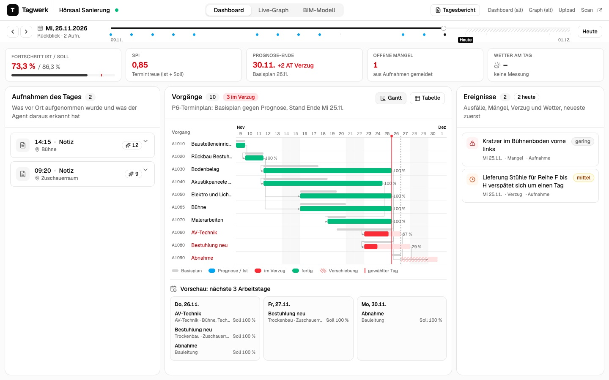
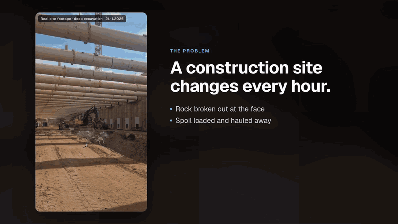
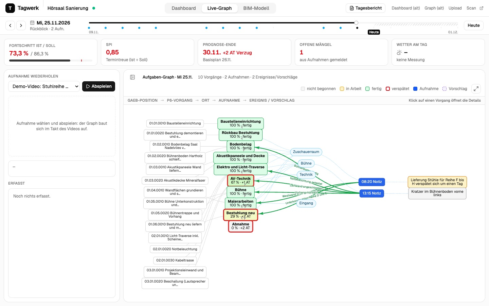
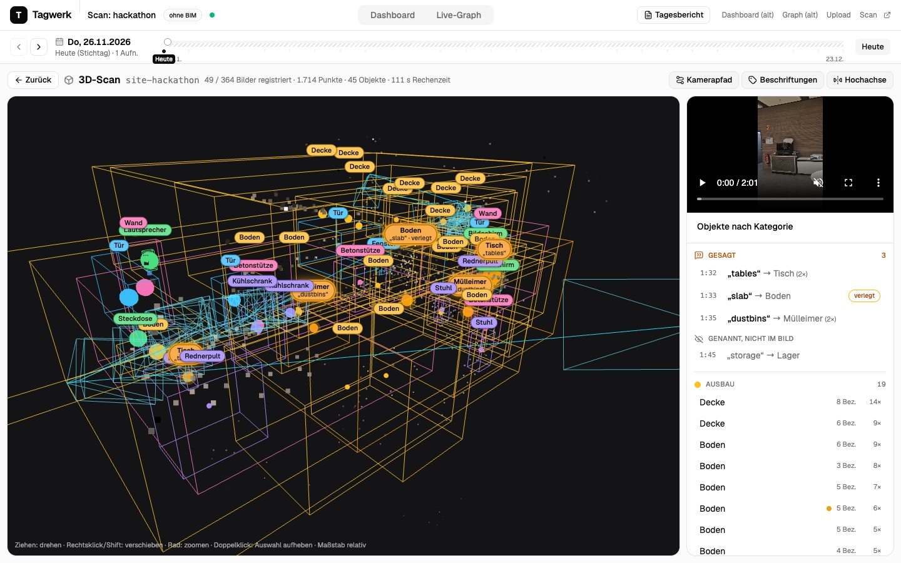
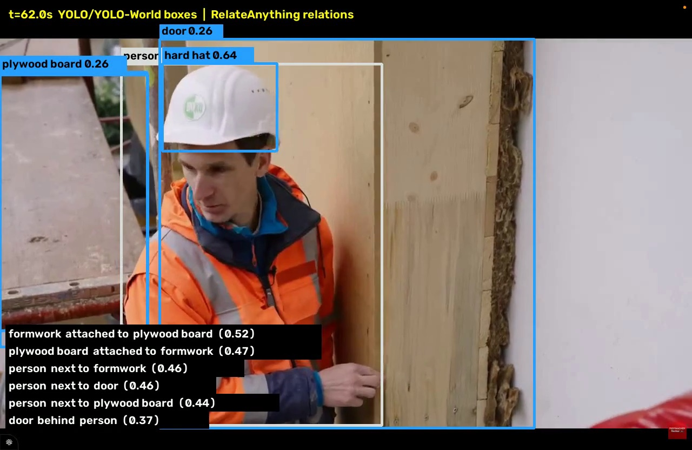
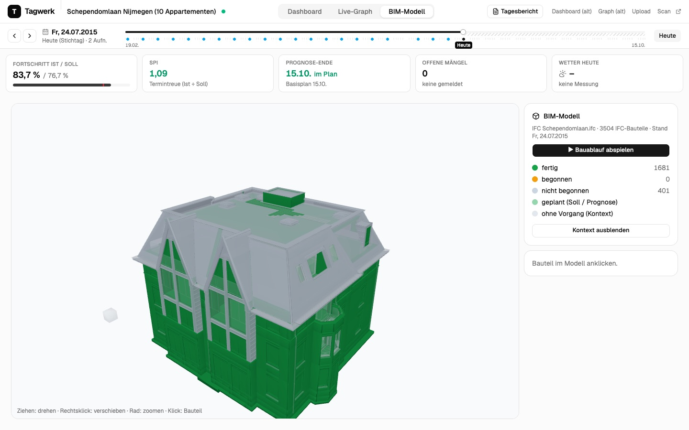
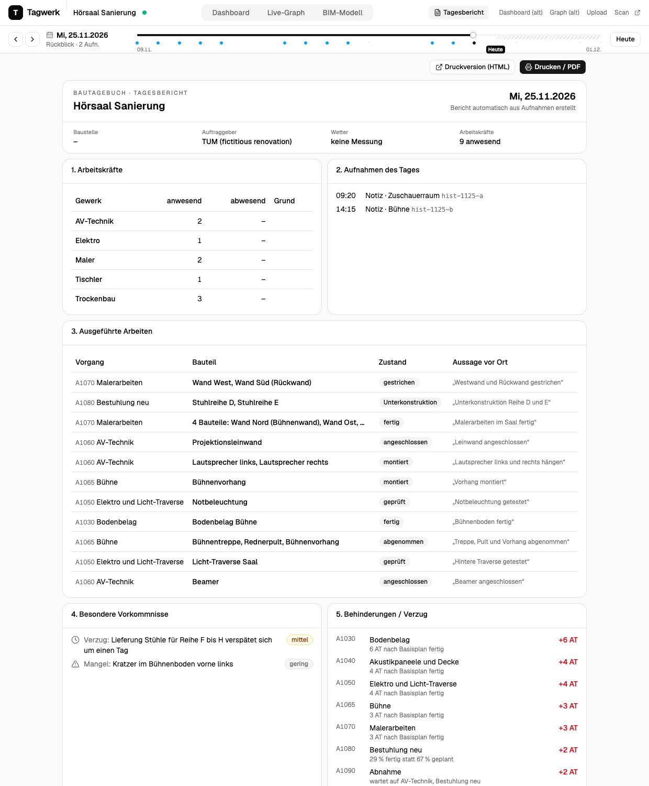
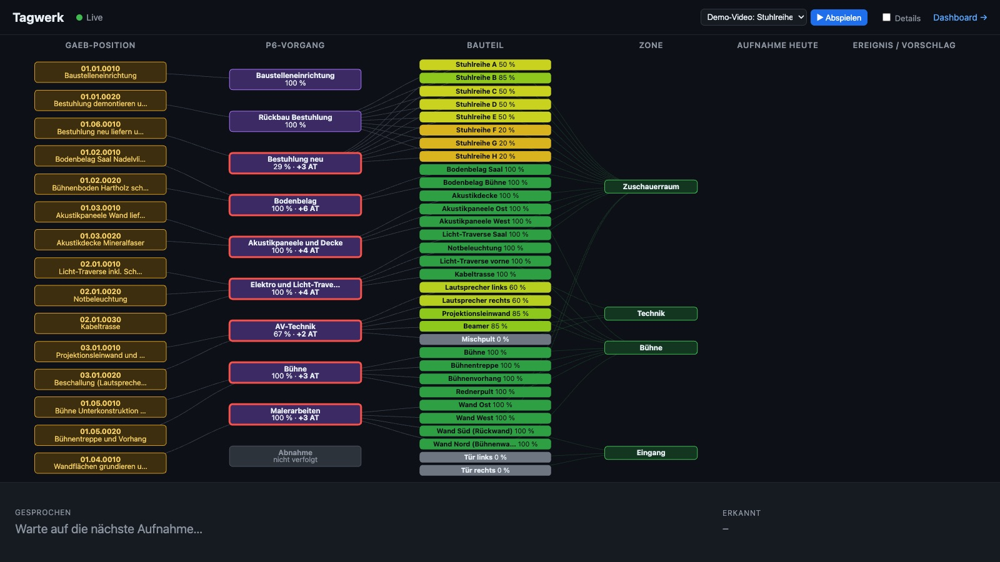
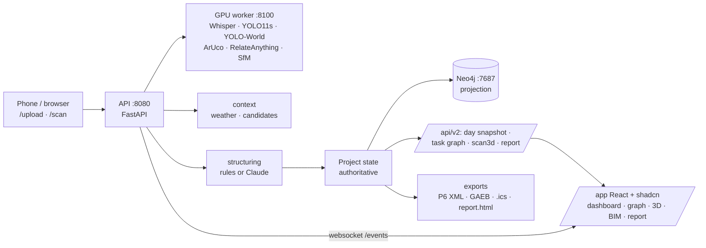

https://github.com/user-attachments/assets/f13b0387-5525-46e4-8874-902b3f160982

[Tagwerk-Pitch.pptx](https://github.com/user-attachments/files/35236461/Tagwerk-Pitch.pptx)
# Tagwerk

The site manager walks the site, films and talks. Tagwerk turns that into:
- element- and task-level progress tied to the contract (GAEB) and the schedule (Primavera P6 XML)
- a 3D scan of the walk, with every detected object tagged
- an automatic daily report (Bautagebuch)
- a dashboard for the Bauleiter, with a day slider over the whole project
- exports back to Primavera and Outlook

Voice and typed notes confirm progress; vision alone only proposes it.



## Pitch: video and deck

Challenge B: AI Site Manager Assistant for Documentation, Daily Reports and Claims.

[](docs/media/tagwerk-submission.mp4)

*Preview (37 s, no sound). Click it or open [the full 2-minute video with narration](docs/media/tagwerk-submission.mp4) (GitHub offers it as a download; it plays in any browser or player).*

| | |
|---|---|
| **Video (2 min)** | [`docs/media/tagwerk-submission.mp4`](docs/media/tagwerk-submission.mp4): real site footage and the problem (four tools, no shared key), then one typed note on the phone ("Stuhlreihe A ist montiert. Zwei Mann vom Trockenbau sind krank. Kratzer an der Bühne.") turning into progress, an absence, a defect and a 2-day delay on the dashboard; the trace to the GAEB position, the live graph, the forecast slider, a camera proposal confirmed with one tap, the daily report and BIM playback. Real screen recordings of the prototype, ElevenLabs narration. Storyboard: [`pitch/STORYBOARD-2min.md`](pitch/STORYBOARD-2min.md). |
| **Deck (7 slides)** | [`docs/design-brief/Tagwerk-Pitch-7.pdf`](docs/design-brief/Tagwerk-Pitch-7.pdf): problem, solution, ontology layer, product, architecture, why it is different, status and next. |
| Long deck (13 slides) | [`Tagwerk-Pitch.pdf`](docs/design-brief/Tagwerk-Pitch.pdf) / [`.pptx`](docs/design-brief/Tagwerk-Pitch.pptx) |
| Sources | Video: Remotion project in [`pitch/video/`](pitch/video/) (`npm run render:submission`). Deck: [`pitch/deck/deck7/`](pitch/deck/deck7/). See [`pitch/README.md`](pitch/README.md). |

**Tagwerk: capture once, linked everywhere.**

## What it does

| | |
|---|---|
| **Capture** | Upload a video, photos, voice or a typed note from the phone (`/upload`). Whisper transcribes German, English and Dutch. YOLO11s + YOLO-World detect objects and ArUco markers. RelateAnything relates the objects to each other. |
| **Understand** | Sentences are matched to elements and activities: names, aliases and German plurals, state words ("montiert", "verlegt", "in Betrieb"), absences ("zwei Mann vom Trockenbau sind krank"), deliveries, defects, delays. A Claude path is available with an API key; keyword rules apply otherwise. |
| **Progress loop** | States only go up. Activity % is BoQ-weighted. The forecast simulates the remaining work day by day, with crew minus absences (a sick report covers 3 working days) and FS/SS successors. |
| **Scan 3D** | pycolmap SfM on the walk's keyframes. Detections are lifted into 3D and merged into one instance per object, with RelateAnything tags in German ("neben Wand", "unter Fenster"). Items you **name while filming** are highlighted at the moment you say them. |
| **Report** | Daily report: work done, crew present/absent, scan inventory with relations, events and defects, delays, a 3-day lookahead, photos, signature line. Print-ready A4 (`/export/report.html`). |
| **Exports** | P6 XML (with progress, or baseline), GAEB DA XML X83/X84, `.ics` with one all-day event per daily report. |

### Live task graph
GAEB position, P6 activity, place, recording, event or proposal. On projects without a BIM model (the Hörsaal) the graph shows tasks instead of building parts. The day slider drives it; `▶ Abspielen` replays a recorded walk.



### Scan 3D with "what was said"
The point cloud, camera path and labelled objects come from the walk itself. The "Gesagt" list links each spoken phrase to its objects; clicking it jumps the video to that moment and flies the camera there. Things named but not seen are listed separately.



### Detections and RelateAnything on real footage
Boxes from YOLO and YOLO-World, with relations from RelateAnything such as "formwork attached to plywood board" and "hard hat on person". Rendered with `annotate.py` from the cached stage outputs.



### BIM model (Schependomlaan)
The IFC design model is coloured by each element's state on the selected day: 3,504 IFC elements, 2,081 linked to activities. "Bauablauf abspielen" plays the build from the schedule.



### Tagesbericht


### Classic live graph with video replay
The original element-level view (`/graph`). A replay plays the recording's video next to it, and each item lands on the graph about when it is said.



## Architecture

Everything runs on the GPU laptop (Ubuntu 22.04, GTX 1060 6 GB). The Mac edits code and opens the UI through an SSH tunnel.



- **Project state** (`tagwerk/project.py`) is authoritative. It is built from the seed CSVs, `seed/history.json` and every stored capture result, all applied through `apply_structured`, which is idempotent and all-or-nothing. The Neo4j graph is a projection of it (`tagwerk/graph/sync.py`, batched `MERGE`s).
- **UI v2** (`web-app/` source, built to `web/app/` and committed, so no Node is needed on the laptop):
  - **API:** `tagwerk/v2.py` rebuilds the state as of any day: `/api/v2/days`, `/api/v2/day`, `/api/v2/taskgraph`, `/api/v2/bim`. Before the first evidence it shows the plan; after the data date, the forecast.
  - **Specs:** the contract is `docs/UI-V2-CONTRACT.md`.
- **Scan 3D** (`tagwerk/pipeline/sfm.py`, `mentions.py`):
  - SfM runs in a subprocess with a time limit and never fails a capture: when reconstruction fails, the objects are kept in 2D.
  - Long walks get denser, sharper frames.
- **Caching and replay:** every stage output lands in `cache/<capture_id>/`, including the kept video. `replay_of=<capture_id>` replays a capture with no GPU, network or Claude.
- **Speech:** faster-whisper, int8. The model is set by `WHISPER_MODEL` (default `small`). Quiet audio is levelled first, and word timestamps are kept.

## Run it (laptop)

```bash
cd ~/Developer/hacka/Tagwerk && export PYTHONPATH=$PWD   # the shell's ROS paths break the venv otherwise
docker compose up -d neo4j
~/tw-restart.sh                      # worker :8100, Hörsaal API :8080 (Neo4j), Schependomlaan API :8081
~/tw-scanproject.sh <name>           # API :8082 on a scan project (seed/projects/<name>)
.venv/bin/python -m pytest -q
```

| Port | Project |
|---|---|
| 8080 | Hörsaal Sanierung (demo seed, no BIM; 10 activities, 15 GAEB positions) |
| 8081 | Schependomlaan Nijmegen (real open BIM dataset; 2,082 elements, 100 tasks) |
| 8082 | a scan project created from a video (`/scan`), e.g. `hackathon` |
| 8100 | GPU worker |

Port 8000 is Portainer on the laptop, so the API runs on 8080.

**Pages:**
- `/app`: the new UI, with Dashboard, Live-Graph, BIM-Modell, `#/scan/<cid>` and `#/report/<date>`.
- The classic pages: `/graph`, `/dashboard`, `/site`, `/upload`, `/scan`.

**Exports:** `/export/p6.xml`, `/export/p6-baseline.xml`, `/export/day.ics`, `/export/boq.x83|x84`, `/export/report.html?date=`.

**Demo runbook:** `docs/DEMO.md`. It covers the 3-minute demo, the hackathon walk, replay and reset.

**`.env`** (never commit it):
- `NEO4J_URI`, `NEO4J_PASSWORD`, `GPU_WORKER_URL=http://localhost:8100`, `DATA_DATE`.
- Optional: `ANTHROPIC_API_KEY` and `WHISPER_MODEL`.
- **Auth:** every endpoint but `/health`, the pages and `/vendor/` needs `API_TOKEN` (header, `?token=` or a cookie).
  - The API refuses to start without one unless `TAGWERK_DEV=1`.
  - `/scan` with "Projekt anlegen" needs `ALLOW_PROJECT_CREATE=1`.
  - Uploads are capped by `MAX_UPLOAD_MB` and `MAX_UPLOAD_FILES`.

## Second project: Schependomlaan (real BIM data)

`seed/projects/schependomlaan/` is generated by `scripts/import_schependomlaan.py` from the open
[Schependomlaan dataset](https://github.com/openBIMstandards/Archive-DataSetSchependomlaan) (CC BY 4.0, academic use; see `ATTRIBUTION.md`).
- **Sources:** the design IFC, the Synchro IFC with the real `IfcTask` schedule and the task-to-element links, and the MS Project XML.
- **The BIM viewer** uses `scripts/ifc_to_bim.py`.
- **History:** weekly Synchro 4D snapshots, which are planned states rather than as-built data. `scripts/build_plan_history.py` fills the days before the first record from the schedule.
- **Dutch notes work:** "twee metselaars ziek", "Sporenkap derde verdieping geplaatst".

## Scan a video into a project

`POST /api/scan` (or `/scan`, or `scripts/scan_video.py clip.mp4 --make-project site1`) does three things:
1. Runs vision, speech terms and SfM.
2. Groups what was seen by category: structure, openings, finishes, building services, furniture, equipment, people.
3. With a project name, writes `seed/projects/<name>/`: one element per instance, one activity per category.

Serve it with `~/tw-scanproject.sh <name>`. Later captures of that site update it by voice.

## Fresh install

API (any machine, CPU is enough):

```bash
cp .env.example .env
docker compose up -d neo4j
uv venv --python 3.12 && source .venv/bin/activate
uv pip install -e ".[dev]"
```

GPU worker (Pascal GPUs such as GTX 1060 or 1080 Ti):

```bash
uv pip install -e ".[gpu,dev]" -c constraints-cu126.txt \
    --extra-index-url https://download.pytorch.org/whl/cu126 --index-strategy unsafe-best-match
uv pip install transformers "git+https://github.com/ultralytics/CLIP.git" ifcopenshell pycolmap -c constraints-cu126.txt \
    --extra-index-url https://download.pytorch.org/whl/cu126 --index-strategy unsafe-best-match
uv pip install --no-deps -e ../RelateAnything    # package "relsgg"
python -c "import torch; print(torch.__version__)"   # must end in +cu126
python scripts/env_check.py
```

Frontend (only to change the UI; the build is committed):

```bash
cd web-app && pnpm install && pnpm build    # writes ../web/app/
```

- **Weights:** `yolo11s.pt` and `yolov8s-worldv2.pt` go in the repo root (gitignored), and CLIP ViT-B/32 in `~/.cache/clip/`.
- **Pascal rules:** torch stays on the cu126 build (never cu128+), fp32 only, no `torch.compile`.

## Tests and CI

```bash
PYTHONPATH=$PWD .venv/bin/python -m pytest -q   # about 235 tests, CPU only, models stubbed
.venv/bin/ruff check .                          # line length 130
```

GitHub Actions runs ruff, fixture validation and pytest on a CPU runner. It has no models and no `PYTHONPATH`, so API tests that post captures monkeypatch speech and vision. `~/tw-doubletest.sh` on the laptop is the full end-to-end check against the real models.

## Layout

| Path | What |
| --- | --- |
| `contracts/`, `fixtures/` | JSON Schemas per stage, one valid example each |
| `tagwerk/api/` | FastAPI app, upload, websocket, exports, `/app` |
| `tagwerk/pipeline/` | normalize, speech, vision, sfm, mentions, context, structure, scan, export |
| `tagwerk/project.py`, `tagwerk/v2.py`, `tagwerk/report.py` | state and forecast, day snapshots and task graph, daily report |
| `tagwerk/graph/` | Neo4j / in-memory graph writer |
| `tagwerk/worker_api.py` | GPU worker service |
| `seed/`, `seed/projects/` | ontology, Hörsaal seed, Schependomlaan and scan projects |
| `web-app/` → `web/app/` | React + shadcn UI (source → committed build) |
| `web/` | classic pages and bundled vendor libraries |
| `scripts/` | import, scan, replay, reset, IFC→BIM, plan history, checks |
| `docs/` | `DEMO.md`, `UI-V2-CONTRACT.md`, reviews, release notes |

## Licences to keep in mind

- **RelateAnything:** AGPL-3.0, with weights under the DINOv3 licence.
- **Schependomlaan dataset:** academic use.
- **Partner and venue footage:** not for redistribution.

Fine for the hackathon; revisit before any commercial use.
